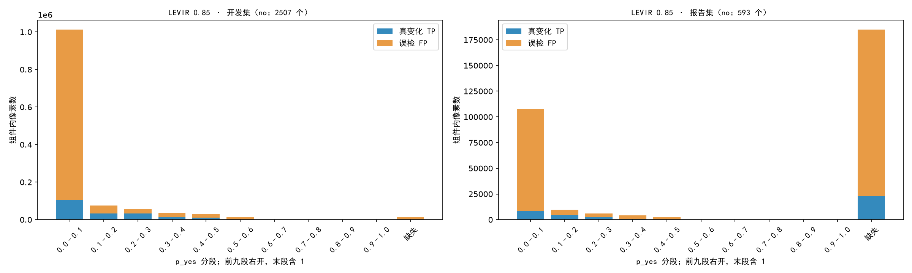
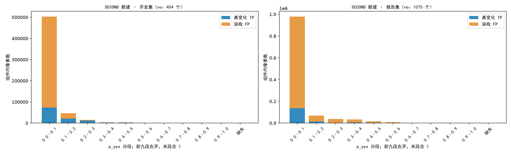
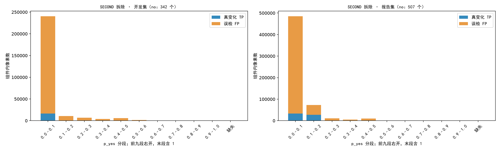
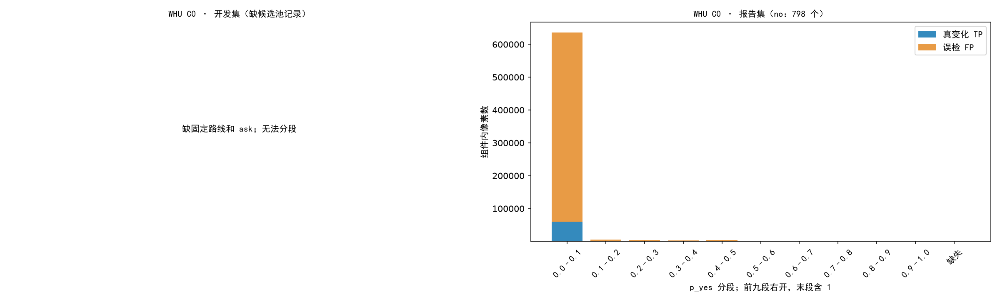
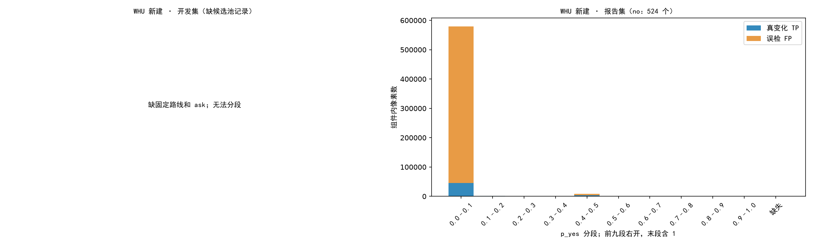
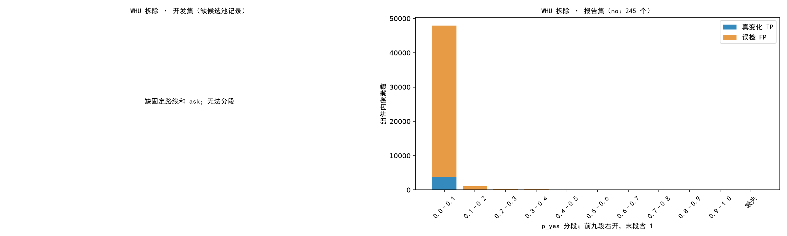

# 验证器 p_yes 离线分析

只读已有记录。未调用 API，未用 GPU，未提交 Slurm。路径均相对 R；外部真值仅列数据集内位置。

F1 为整集累计像素分数（0–100）；变化单位为分。按图配对 bootstrap 5000 次，种子 1016，95% 百分位区间。
规则只删除 answer=no。未解析和缺答案保留。p_yes 缺失单列，绝不以二值答案填充。
固定网格 0, 0.1, …, 1，候选为全部 a<b 的闭区间 [a,b]，另含“不保留任何 no”。只在开发集最大化 F1；并列取更窄，再取更低区间。
完美复核仅保留 TP>FP 的整组件（恰好一半不留）；真值只用于天花板，不代表可实现的复核器，也不是所有组件子集的数学最优值。

## 盘点

| 池 | 划分 | 图（有掩码/应有） | 组件 | 答案 | 可读 p_yes | no 可读/总数 |
|---|---|---:|---:|---:|---:|---:|
| LEVIR 0.85 | 开发 | 200/200 | 11956 | 11956 | 11867（99.26%） | 2492/2507 |
| LEVIR 0.85 | 报告 | 64/64 | 3295 | 3295 | 1490（45.22%） | 252/593 |
| SECOND 新建 | 开发 | 60/60 | 661 | 661 | 661（100.00%） | 404/404 |
| SECOND 新建 | 报告 | 128/128 | 1840 | 1840 | 1840（100.00%） | 1075/1075 |
| SECOND 拆除 | 开发 | 60/60 | 461 | 461 | 461（100.00%） | 342/342 |
| SECOND 拆除 | 报告 | 128/128 | 745 | 745 | 745（100.00%） | 507/507 |
| WHU C0 | 开发 | 0/60 | 未知（缺掩码） | 0 | 0（无法统计） | 0/0 |
| WHU C0 | 报告 | 128/128 | 1322 | 1322 | 1322（100.00%） | 798/798 |
| WHU 新建 | 开发 | 0/60 | 未知（缺掩码） | 0 | 0（无法统计） | 0/0 |
| WHU 新建 | 报告 | 128/128 | 1011 | 1011 | 1011（100.00%） | 524/524 |
| WHU 拆除 | 开发 | 0/60 | 未知（缺掩码） | 0 | 0（无法统计） | 0/0 |
| WHU 拆除 | 报告 | 128/128 | 318 | 318 | 318（100.00%） | 245/245 |

## 固定区间的结果

| 池 | 开发区间 | 开发规则→区间 F1 | 报告规则→区间 F1 | 报告 Δ [95% CI] | 完美复核区间 Δ | 全部 no 完美复核 Δ |
|---|---|---|---|---|---|---|
| LEVIR 0.85 | [0.1, 0.3] | 83.87→83.98 | 86.35→86.35 | -0.002 [-0.09, +0.10] | +0.11 | +0.63 |
| SECOND 新建 | [0.1, 0.5] | 65.07→66.65 | 63.74→62.85 | -0.88 [-1.88, -0.02] | +0.66 | +4.29 |
| SECOND 拆除 | 不恢复 no | 45.06→45.06 | 37.96→37.96 | +0.00 [+0.00, +0.00] | +0.00 | +6.92 |
| WHU C0 | 无开发记录，未选择 | — | 62.75→未评估 | — | — | +0.67 |
| WHU 新建 | 无开发记录，未选择 | — | 70.26→未评估 | — | — | +0.58 |
| WHU 拆除 | 无开发记录，未选择 | — | 22.17→未评估 | — | — | +0.37 |

全部 no 天花板包括 p_yes 缺失组件。WHU 的天花板仅作诊断，不能代替开发集选型或据此启动 G6。区间固定，bootstrap 中不重新选区间。

## 问法、模型和 settings

- LEVIR 0.85：L1=f37_corr，模型 qwen3.7-flash，四图对应问法。dev2 与报告集使用同一变体；ask_eval 无独立 settings。历史 p_yes 可读率不同，不能据此假设请求完全同分布。
  - 开发：names=`dev2/names.txt`；mask_dir=`init/sam3_imc_p85/train`；answers=`ask_eval/dev2/f37_corr.jsonl`。
  - 报告：names=`dev2/val_names.txt`；mask_dir=`init/sam3_imc_p85/val`；answers=`ask_eval/val_sam3_imc_p85/f37_corr.jsonl`。
- SECOND 新建：settings：开发 scope=dev_card_defined，报告 scope=building_rebuild_excluded，名称不同；已逐字段核对 code_k 中开发范围卡与当前最终卡，内容完全相同（含“范围卡加一句定义”）。direction、f37_corr 相同；模型按变体定义为 qwen3.7-flash。未归档逐请求完整 prompt，不能验证服务端历史变更。
  - 开发：names=`second_dev/names.txt`；mask_dir=`second_dev/second/fixed/appeared`；answers=`second_dev/rule_card_defined/appeared/appeared/answers.jsonl`；settings=`second_dev/rule_card_defined/appeared/appeared/settings.json`；saved_rule=`second_dev/rule_card_defined/appeared/appeared/masks`。
  - 报告：names=`second/second_val128.txt`；mask_dir=`second/fixed/appeared`；answers=`second/rule/appeared/answers.jsonl`；settings=`second/rule/appeared/settings.json`；saved_rule=`second/rule/appeared/masks`。
- SECOND 拆除：settings：开发 scope=dev_card_defined，报告 scope=building_rebuild_excluded，名称不同；已逐字段核对 code_k 中开发范围卡与当前最终卡，内容完全相同（含“范围卡加一句定义”）。direction、f37_corr 相同；模型按变体定义为 qwen3.7-flash。未归档逐请求完整 prompt，不能验证服务端历史变更。
  - 开发：names=`second_dev/names.txt`；mask_dir=`second_dev/second/fixed/disappeared`；answers=`second_dev/rule_card_defined/disappeared/disappeared/answers.jsonl`；settings=`second_dev/rule_card_defined/disappeared/disappeared/settings.json`；saved_rule=`second_dev/rule_card_defined/disappeared/disappeared/masks`。
  - 报告：names=`second/second_val128.txt`；mask_dir=`second/fixed/disappeared`；answers=`second/rule/disappeared/answers.jsonl`；settings=`second/rule/disappeared/settings.json`；saved_rule=`second/rule/disappeared/masks`。
- WHU C0：报告 settings：building_rebuild_excluded + f37_corr，模型定义为 qwen3.7-flash，与 SECOND 最终范围卡同口径。开发图未找到固定路线和 ask，无法比较开发请求。报告 answers 中没有开发图 uid。
  - 开发：names=`whu/names_dev60.txt`；mask_dir=`whu/fixed/any`；answers=`whu/rule/any/answers.jsonl`。
  - 报告：names=`whu/names_val128.txt`；mask_dir=`whu/fixed/any`；answers=`whu/rule/any/answers.jsonl`；settings=`whu/rule/any/settings.json`；saved_rule=`whu/rule/any/masks`。
- WHU 新建：报告 settings：building_rebuild_excluded + f37_corr，模型定义为 qwen3.7-flash，与 SECOND 最终范围卡同口径。开发图未找到固定路线和 ask，无法比较开发请求。报告 answers 中没有开发图 uid。
  - 开发：names=`whu/names_dev60.txt`；mask_dir=`whu/fixed/appeared`；answers=`whu/rule/appeared/answers.jsonl`。
  - 报告：names=`whu/names_val128.txt`；mask_dir=`whu/fixed/appeared`；answers=`whu/rule/appeared/answers.jsonl`；settings=`whu/rule/appeared/settings.json`；saved_rule=`whu/rule/appeared/masks`。
- WHU 拆除：报告 settings：building_rebuild_excluded + f37_corr，模型定义为 qwen3.7-flash，与 SECOND 最终范围卡同口径。开发图未找到固定路线和 ask，无法比较开发请求。报告 answers 中没有开发图 uid。
  - 开发：names=`whu/names_dev60.txt`；mask_dir=`whu/fixed/disappeared`；answers=`whu/rule/disappeared/answers.jsonl`。
  - 报告：names=`whu/names_val128.txt`；mask_dir=`whu/fixed/disappeared`；answers=`whu/rule/disappeared/answers.jsonl`；settings=`whu/rule/disappeared/settings.json`；saved_rule=`whu/rule/disappeared/masks`。

## no 组件分段

### LEVIR 0.85

| 划分 | p_yes | 组件数 | TP 像素 | FP 像素 |
|---|---|---:|---:|---:|
| 开发 | [0.0,0.1) | 2161 | 103366 | 909392 |
| 开发 | [0.1,0.2) | 118 | 33286 | 41901 |
| 开发 | [0.2,0.3) | 80 | 32434 | 24591 |
| 开发 | [0.3,0.4) | 57 | 13703 | 21895 |
| 开发 | [0.4,0.5) | 58 | 9863 | 20780 |
| 开发 | [0.5,0.6) | 18 | 706 | 14315 |
| 开发 | [0.6,0.7) | 0 | 0 | 0 |
| 开发 | [0.7,0.8) | 0 | 0 | 0 |
| 开发 | [0.8,0.9) | 0 | 0 | 0 |
| 开发 | [0.9,1.0] | 0 | 0 | 0 |
| 开发 | p_yes 缺失 | 15 | 1577 | 11112 |
| 报告 | [0.0,0.1) | 210 | 8710 | 99296 |
| 报告 | [0.1,0.2) | 17 | 4454 | 5196 |
| 报告 | [0.2,0.3) | 12 | 2272 | 3807 |
| 报告 | [0.3,0.4) | 8 | 909 | 3152 |
| 报告 | [0.4,0.5) | 5 | 0 | 2214 |
| 报告 | [0.5,0.6) | 0 | 0 | 0 |
| 报告 | [0.6,0.7) | 0 | 0 | 0 |
| 报告 | [0.7,0.8) | 0 | 0 | 0 |
| 报告 | [0.8,0.9) | 0 | 0 | 0 |
| 报告 | [0.9,1.0] | 0 | 0 | 0 |
| 报告 | p_yes 缺失 | 341 | 22999 | 161956 |
### SECOND 新建

| 划分 | p_yes | 组件数 | TP 像素 | FP 像素 |
|---|---|---:|---:|---:|
| 开发 | [0.0,0.1) | 360 | 73819 | 429486 |
| 开发 | [0.1,0.2) | 22 | 21808 | 24602 |
| 开发 | [0.2,0.3) | 10 | 12434 | 2518 |
| 开发 | [0.3,0.4) | 5 | 2632 | 311 |
| 开发 | [0.4,0.5) | 6 | 2455 | 1069 |
| 开发 | [0.5,0.6) | 1 | 0 | 397 |
| 开发 | [0.6,0.7) | 0 | 0 | 0 |
| 开发 | [0.7,0.8) | 0 | 0 | 0 |
| 开发 | [0.8,0.9) | 0 | 0 | 0 |
| 开发 | [0.9,1.0] | 0 | 0 | 0 |
| 开发 | p_yes 缺失 | 0 | 0 | 0 |
| 报告 | [0.0,0.1) | 968 | 137780 | 841212 |
| 报告 | [0.1,0.2) | 37 | 14111 | 54378 |
| 报告 | [0.2,0.3) | 29 | 2723 | 35755 |
| 报告 | [0.3,0.4) | 27 | 7348 | 26956 |
| 报告 | [0.4,0.5) | 8 | 4586 | 11397 |
| 报告 | [0.5,0.6) | 6 | 2953 | 6131 |
| 报告 | [0.6,0.7) | 0 | 0 | 0 |
| 报告 | [0.7,0.8) | 0 | 0 | 0 |
| 报告 | [0.8,0.9) | 0 | 0 | 0 |
| 报告 | [0.9,1.0] | 0 | 0 | 0 |
| 报告 | p_yes 缺失 | 0 | 0 | 0 |
### SECOND 拆除

| 划分 | p_yes | 组件数 | TP 像素 | FP 像素 |
|---|---|---:|---:|---:|
| 开发 | [0.0,0.1) | 299 | 16530 | 223924 |
| 开发 | [0.1,0.2) | 12 | 0 | 10516 |
| 开发 | [0.2,0.3) | 16 | 696 | 6379 |
| 开发 | [0.3,0.4) | 7 | 728 | 3297 |
| 开发 | [0.4,0.5) | 6 | 0 | 5832 |
| 开发 | [0.5,0.6) | 2 | 0 | 1433 |
| 开发 | [0.6,0.7) | 0 | 0 | 0 |
| 开发 | [0.7,0.8) | 0 | 0 | 0 |
| 开发 | [0.8,0.9) | 0 | 0 | 0 |
| 开发 | [0.9,1.0] | 0 | 0 | 0 |
| 开发 | p_yes 缺失 | 0 | 0 | 0 |
| 报告 | [0.0,0.1) | 442 | 33216 | 451790 |
| 报告 | [0.1,0.2) | 32 | 26987 | 45531 |
| 报告 | [0.2,0.3) | 15 | 459 | 10589 |
| 报告 | [0.3,0.4) | 8 | 1423 | 4215 |
| 报告 | [0.4,0.5) | 8 | 1595 | 7982 |
| 报告 | [0.5,0.6) | 2 | 23 | 554 |
| 报告 | [0.6,0.7) | 0 | 0 | 0 |
| 报告 | [0.7,0.8) | 0 | 0 | 0 |
| 报告 | [0.8,0.9) | 0 | 0 | 0 |
| 报告 | [0.9,1.0] | 0 | 0 | 0 |
| 报告 | p_yes 缺失 | 0 | 0 | 0 |
### WHU C0

| 划分 | p_yes | 组件数 | TP 像素 | FP 像素 |
|---|---|---:|---:|---:|
| 开发 | [0.0,0.1) | 0 | 0 | 0 |
| 开发 | [0.1,0.2) | 0 | 0 | 0 |
| 开发 | [0.2,0.3) | 0 | 0 | 0 |
| 开发 | [0.3,0.4) | 0 | 0 | 0 |
| 开发 | [0.4,0.5) | 0 | 0 | 0 |
| 开发 | [0.5,0.6) | 0 | 0 | 0 |
| 开发 | [0.6,0.7) | 0 | 0 | 0 |
| 开发 | [0.7,0.8) | 0 | 0 | 0 |
| 开发 | [0.8,0.9) | 0 | 0 | 0 |
| 开发 | [0.9,1.0] | 0 | 0 | 0 |
| 开发 | p_yes 缺失 | 0 | 0 | 0 |
| 报告 | [0.0,0.1) | 769 | 60553 | 575501 |
| 报告 | [0.1,0.2) | 12 | 1263 | 4584 |
| 报告 | [0.2,0.3) | 8 | 233 | 4616 |
| 报告 | [0.3,0.4) | 5 | 1 | 2842 |
| 报告 | [0.4,0.5) | 4 | 1241 | 3607 |
| 报告 | [0.5,0.6) | 0 | 0 | 0 |
| 报告 | [0.6,0.7) | 0 | 0 | 0 |
| 报告 | [0.7,0.8) | 0 | 0 | 0 |
| 报告 | [0.8,0.9) | 0 | 0 | 0 |
| 报告 | [0.9,1.0] | 0 | 0 | 0 |
| 报告 | p_yes 缺失 | 0 | 0 | 0 |
### WHU 新建

| 划分 | p_yes | 组件数 | TP 像素 | FP 像素 |
|---|---|---:|---:|---:|
| 开发 | [0.0,0.1) | 0 | 0 | 0 |
| 开发 | [0.1,0.2) | 0 | 0 | 0 |
| 开发 | [0.2,0.3) | 0 | 0 | 0 |
| 开发 | [0.3,0.4) | 0 | 0 | 0 |
| 开发 | [0.4,0.5) | 0 | 0 | 0 |
| 开发 | [0.5,0.6) | 0 | 0 | 0 |
| 开发 | [0.6,0.7) | 0 | 0 | 0 |
| 开发 | [0.7,0.8) | 0 | 0 | 0 |
| 开发 | [0.8,0.9) | 0 | 0 | 0 |
| 开发 | [0.9,1.0] | 0 | 0 | 0 |
| 开发 | p_yes 缺失 | 0 | 0 | 0 |
| 报告 | [0.0,0.1) | 512 | 44971 | 534343 |
| 报告 | [0.1,0.2) | 4 | 1180 | 567 |
| 报告 | [0.2,0.3) | 2 | 0 | 754 |
| 报告 | [0.3,0.4) | 0 | 0 | 0 |
| 报告 | [0.4,0.5) | 5 | 4042 | 4195 |
| 报告 | [0.5,0.6) | 1 | 146 | 8 |
| 报告 | [0.6,0.7) | 0 | 0 | 0 |
| 报告 | [0.7,0.8) | 0 | 0 | 0 |
| 报告 | [0.8,0.9) | 0 | 0 | 0 |
| 报告 | [0.9,1.0] | 0 | 0 | 0 |
| 报告 | p_yes 缺失 | 0 | 0 | 0 |
### WHU 拆除

| 划分 | p_yes | 组件数 | TP 像素 | FP 像素 |
|---|---|---:|---:|---:|
| 开发 | [0.0,0.1) | 0 | 0 | 0 |
| 开发 | [0.1,0.2) | 0 | 0 | 0 |
| 开发 | [0.2,0.3) | 0 | 0 | 0 |
| 开发 | [0.3,0.4) | 0 | 0 | 0 |
| 开发 | [0.4,0.5) | 0 | 0 | 0 |
| 开发 | [0.5,0.6) | 0 | 0 | 0 |
| 开发 | [0.6,0.7) | 0 | 0 | 0 |
| 开发 | [0.7,0.8) | 0 | 0 | 0 |
| 开发 | [0.8,0.9) | 0 | 0 | 0 |
| 开发 | [0.9,1.0] | 0 | 0 | 0 |
| 开发 | p_yes 缺失 | 0 | 0 | 0 |
| 报告 | [0.0,0.1) | 237 | 3830 | 44105 |
| 报告 | [0.1,0.2) | 4 | 15 | 1055 |
| 报告 | [0.2,0.3) | 2 | 59 | 132 |
| 报告 | [0.3,0.4) | 1 | 0 | 316 |
| 报告 | [0.4,0.5) | 1 | 2 | 0 |
| 报告 | [0.5,0.6) | 0 | 0 | 0 |
| 报告 | [0.6,0.7) | 0 | 0 | 0 |
| 报告 | [0.7,0.8) | 0 | 0 | 0 |
| 报告 | [0.8,0.9) | 0 | 0 | 0 |
| 报告 | [0.9,1.0] | 0 | 0 | 0 |
| 报告 | p_yes 缺失 | 0 | 0 | 0 |

## 需要补问（只列清单，未执行）

| 池 | 原因 | 组件数 | 请求数 | 估计费用（元） |
|---|---|---:|---:|---:|
| levir_dev | 已有 ask 的 p_yes 缺失 | 89 | 89 | 0.0212 |
| levir_report | 已有 ask 的 p_yes 缺失 | 1805 | 1805 | 4.2920 |
| whu_any_dev | 开发固定掩码缺失，开发 ask 缺失；先生成固定路线再点数组件 | 未知 | 未知；预算暂按 620 | 0.1525 |
| whu_appeared_dev | 开发固定掩码缺失，开发 ask 缺失；先生成固定路线再点数组件 | 未知 | 未知；预算暂按 474 | 0.1174 |
| whu_disappeared_dev | 开发固定掩码缺失，开发 ask 缺失；先生成固定路线再点数组件 | 未知 | 未知；预算暂按 150 | 0.0374 |

不重叠项目合计预算约 4.6204 元。每组件一请求；缺失概率的补问包含已有 yes 和 no。只补 no 的备选请求数也保存在 JSON。重问不能保证得到 p_yes，不能无上限重试。

费用按原记录 cost_cny 的均价（已有 ledger 口径），不是新调用实测或账单。LEVIR 报告记录保留了早期较高计价；不把它当作当前 flash 单价。WHU 开发预算沿用同方向报告均价，组件数按 60/128 的报告密度估计。改首词元格式来提高可读率会改变问法；若决定补问，应另列实验，不与原记录直接混作同一池。

## 结论

LEVIR 0.85：开发区间迁移到报告集的 ΔF1=-0.002 分，未达到 +1 分门槛；区间内完美复核为 +0.11 分。
SECOND 新建：开发区间迁移到报告集的 ΔF1=-0.88 分，未达到 +1 分门槛；区间内完美复核为 +0.66 分。
SECOND 拆除：开发区间迁移到报告集的 ΔF1=+0.00 分，未达到 +1 分门槛；区间内完美复核为 +0.00 分。
WHU C0：开发数据缺失，不能判断开发区间是否达到 +1 分；全部 no 的 TP 主导组件天花板为 +0.67 分，仅作诊断。
WHU 新建：开发数据缺失，不能判断开发区间是否达到 +1 分；全部 no 的 TP 主导组件天花板为 +0.58 分，仅作诊断。
WHU 拆除：开发数据缺失，不能判断开发区间是否达到 +1 分；全部 no 的 TP 主导组件天花板为 +0.37 分，仅作诊断。
SECOND 全部 no 的 TP 主导组件天花板为新建 +4.29、拆除 +6.92 分；它与开发区间迁移收益是两项结果，不能把天花板写成已通过区间迁移门槛。
第 10.5 节 V1 在 dev2 全 200 张为 +0.34，但追加的独立 170 张确认区间跨零，因此 L2 没上线；不是证明 V1 无效。V4 针对置信读数可用性。本次利用已有 L1 的 p_yes，不修复 V4，也不证明 flash 规划器复核能实现真值天花板；需统计复核引入的 FP 和净收益。

## 局限

WHU 开发 60 张没有固定路线掩码和 ask；组件数与精确请求数不可从现有文件恢复，费用按报告池组件密度作预算估计。
置信读数不是校准概率。缺失与问法、历史请求有关，不能当随机缺失。LEVIR 验证集过去已用于问法开发，本次只保证区间由 dev2 选择。
未补问，未运行 Agent，未设计或上线 G6；由 Claude 审核后决定是否补问。
