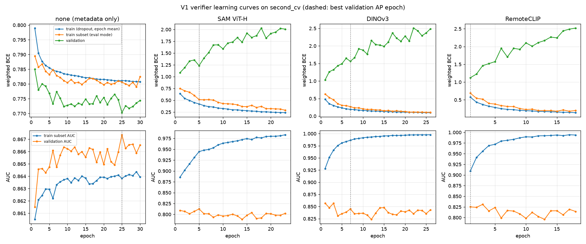

# 实验 6b：切块级验证器（V1 完成，V2 训练中，V3 未定）

任务：仓库 `doc/exp6_verifier.md` 的 6b。代码：`probe/exp6b_features.py`（图像特征）、`exp6b_train.py`（训练）、`exp6b_eval.py`（选阈值与评估）、`exp6b_report.py`（汇总表），公共部分在 `exp6b_common.py`、`exp6_pool_io.py`。完整表格：`interim/exp6/tables_6b_6e.md`。

**状态（2026-10-20）**：V1 的四个版本（无骨干基线 + 三个骨干）在 SECOND 上全部完成。V2a / V2b（Qwen3.5-4B + LoRA）正在训练，预计当天晚上出结果。V3 视 V2 结果决定。本文件是**阶段性结果，供解读**，结论只针对 V1。

## 做了什么

**任务**：给候选池里的每个切块打一个分，表示"这块是真的漏检"的概率。分数高于阈值的切块并入检测器预测（补漏）。同一个模型也给检测器预测里的切块打分，分数低的删掉（去误检，6e）。

**训练数据**：6a 的交叉拟合候选池（`results/exp6a_pool.md`）。SECOND train 的 2,968 张图里：
- 2,671 张训练（255.6 万个有标签补漏切块，正例率 15.27%）；
- 297 张作验证（28.6 万块），用于早停和选阈值。

测试集只评估一次，不参与任何选择。

**V1 的输入**（每个切块一行）：
- **图像特征**：每期整图过一遍冻结骨干，在切块掩码内和切块外接框内分别取特征平均，得到 f1、f2、c1、c2，再加 |f1−f2|、|c1−c2| 和余弦相似度。1024 维的骨干用固定随机投影降到 256 维。
- **元数据**：检测器概率在切块内的均值、最大值、最小值、90% 分位数，面积对数，来源（B、G0.05、C1、C2、H1）独热编码，是否切细。
- **无骨干基线（none）**：只用元数据，不用图像特征，作为对照。

**V1 模型**：两层 MLP（512 → 256），dropout 0.15，AdamW lr 1e-3。用 BCE 训练，正例权重 = 负/正 = 5.55。按验证集 AP 早停，耐心 7 轮。

**骨干**：SAM ViT-H 图像编码器（实验 5 AnyChange 用的同一个）、DINOv3 ViT-L 卫星版（SAT-493M）、RemoteCLIP ViT-L/14。

**阈值**：在验证集 297 张图上扫阈值，取补漏 ΔF1 最大的那个，三种来源组合各选一次（B+G0.05、B+G0.05+H1、全部来源）。去误检阈值同样在验证集上选。

## 结果

### 1. 打分能力：图像特征没有带来提升

补漏切块分类，有标签切块。AUC、AP 范围 0–1；误检率为百分数。

| 版本 | 验证 AUC | 验证 AP | 测试 AUC | 测试 AP | 测试召回 80% 误检率 | 最佳轮次 |
|---|---:|---:|---:|---:|---:|---:|
| **none（无骨干）** | **0.867** | **0.595** | **0.874** | **0.625** | **22.5%** | 25 |
| SAM ViT-H | 0.813 | 0.505 | 0.816 | 0.501 | 32.7% | 5 |
| DINOv3 | 0.845 | 0.578 | 0.833 | 0.557 | 30.4% | 7 |
| RemoteCLIP | 0.825 | 0.521 | 0.836 | 0.527 | 28.4% | 1 |

- 三个骨干的 AUC 都比只用元数据的基线低 0.03–0.06。按来源拆开看，测试集上 B、G0.05、H1、C 四类来源也都是基线最好（验证集上只有 C1 一项 DINOv3 略高，见完整表格）。
- 骨干版本在第 1–7 轮就达到验证集最好，之后变差；基线到第 25 轮。学习曲线（下一节）证实这是背训练样本。
- 测试和验证的 AUC 接近（相差不到 0.015），打分能力本身在测试集上没有明显退化。

### 1b. 学习曲线：骨干版本从第 1 轮起就在背训练样本

为看清训练过程，用同一种子、同一数据重跑了四个版本，不早停，最多 30 轮（第 1 轮结果与原训练一致，可复现）。每轮额外记录两样东西：验证集 loss，以及从训练集固定抽出的 30 万块在评估模式（无 dropout）下的 loss 和 AUC。loss 都是训练用的加权 BCE。日志：`interim/exp6/v1_train_logs/`（`early_stop/` 是原训练，`curve_30ep/` 是重跑；推送时骨干版本的重跑还在进行，分别到第 18–26 轮）。

| 版本 | 轮次 | 训练子集 AUC | 验证 AUC | 训练子集 loss | 验证 loss |
|---|---:|---:|---:|---:|---:|
| none | 1 | 0.861 | 0.862 | 0.79 | 0.785 |
| none | 30 | 0.864 | 0.867 | 0.78 | 0.774 |
| SAM ViT-H | 1 | 0.886 | 0.809 | 0.75 | 1.08 |
| SAM ViT-H | 17 | 0.977 | 0.790 | 0.35 | 1.87 |
| DINOv3 | 1 | 0.928 | 0.857 | 0.63 | 1.03 |
| DINOv3 | 20 | 0.997 | 0.839 | 0.13 | 2.28 |
| RemoteCLIP | 1 | 0.909 | 0.825 | 0.69 | 1.12 |
| RemoteCLIP | 11 | 0.989 | 0.812 | 0.24 | 2.01 |

- **无骨干基线没有过拟合**：训练与验证曲线几乎重合，30 轮内 AUC 都在 0.86–0.87。
- **三个骨干版本是典型的背训练样本**：训练子集 AUC 一路升到 0.98–0.997，验证 AUC 停在 0.79–0.86 不动；验证 loss 从第 1 轮起基本单调上升，到后期翻倍。
- **差距在第 1 轮结束时已经形成**：一轮要过 255 万个切块，训练子集与验证集 AUC 已差 0.07–0.08，验证 loss（1.03–1.12）已明显高于基线（0.785）。所以早停救不回来，加训练轮数也不会改变结论。
- **解读**：冻结骨干 + 掩码内平均池化得到的图像特征，主要让模型认出"这是哪张训练图、哪片场景"，而不是学到可以迁移到新图像的变化判别信号。2,671 张训练图内切块高度相关，有效样本远少于 255 万。这更像是这种特征用法本身的问题，而不是训练设置的问题；6f 的 B1（图像特征只做残差修正）、B2（降维）和 C（原分辨率小网络）针对的就是这一点。

### 2. 补漏：F1/2 门槛没有跨过

门槛：并入像素的精度要高于当前 F1 的一半，F1 才会涨。验证集 F1 71.41，门槛 35.7%；测试集 F1 74.17，门槛 37.08%。

下表的"召回 80%"是诊断口径：在当前数据集上取能找回 80% 有标签正块的阈值，看此时并入的全部像素中真变化占多少。

| 版本 | 验证集召回 80% 像素精度 | 测试集召回 80% 像素精度 |
|---|---:|---:|
| none | 25.8% | 21.3% |
| SAM ViT-H | 18.2% | 16.5% |
| DINOv3 | 22.6% | 17.9% |
| RemoteCLIP | 20.0% | 18.5% |

四个版本都远低于门槛。也就是说，要想找回大部分漏检，补进来的假变化一定比真变化多。

**端到端**：阈值在验证集上按 ΔF1 最大选定，测试集只评估一次。ΔF1 为百分点。

| 版本 | 验证 ΔF1（B+G0.05 / +H1 / 全部） | 测试 ΔF1（B+G0.05 / +H1 / 全部） | 选定阈值（+H1） |
|---|---|---|---:|
| none | +0.12 / +0.14 / +0.11 | −0.66 / −1.31 / −0.79 | 0.820 |
| SAM ViT-H | +0.18 / +0.20 / +0.17 | −0.20 / −0.27 / −0.29 | 0.982 |
| DINOv3 | +0.54 / +0.62 / +0.63 | −0.78 / −0.87 / −0.59 | 0.908 |
| RemoteCLIP | +0.15 / +0.20 / +0.19 | −0.27 / −0.49 / −0.52 | 0.947 |

- **验证集上全部为正，测试集上全部为负。**
- 验证集上能为正，是因为阈值选得很紧（0.82–0.98），只并入分数最高的一小部分切块。这部分在验证集上的像素精度略高于门槛：B+G0.05+H1 下为 none 36.8%、SAM 42.4%、DINOv3 41.5%、RemoteCLIP 39.8%。
- 同一阈值到测试集上，并入像素的精度都降到 30–31%，低于 37.08% 的门槛。同时每张图并入的像素多了 1.3–1.6 倍（none 每图 6,693 → 10,899 像素）。
- SAM 版测试集亏得最少，只是因为它的阈值最紧、并入最少（测试集每图约 2,160 像素，none 是 10,899），不代表它判断得更准。它的 AUC 是四个里最低的。
- 目标级召回确实上升：以 DINOv3 为例，测试集目标召回 50.6% → 57.8%。但新增的假变化像素约是新增真变化像素的 2.2 倍，整体 F1 下降。

**验证集为正、测试集为负的原因（推测，尚未单独验证）**：6a 发现，官方检测器在测试集候选上的概率普遍比交叉拟合检测器高。补漏候选的检测器概率中位数，训练池 0.004、测试池 0.037；G0.05 每图块数，训练池 90、测试池 219（见 `interim/exp6/pool_tables_6a.md`）。验证器用了检测器概率作输入，测试集切块因此整体得分偏高，同一阈值放进了更多、也更差的切块。下一步用"图内排名"替代概率绝对值来检验这一点（见末节）。

### 3. 去误检：没有超过检测器自身概率

在检测器 0.5 二值预测切出的切块（pred 切块）上判断哪些是误检，测试集 AUC：

| 打分方式 | 测试集 pred 切块 AUC |
|---|---:|
| 检测器自身平均概率（对照） | **0.784** |
| none | 0.785 |
| SAM ViT-H | 0.704 |
| DINOv3 | 0.763 |
| RemoteCLIP | 0.720 |

验证集上选出的删除阈值几乎不删任何东西，测试集 ΔF1 都在 ±0.002 之内。V1 只用补漏切块训练，没见过 pred 切块，这一结果在意料之中。用补漏 + pred 切块一起重训（`--include_pred`）还没做。

## 对判断问题的阶段性回答

1. **验证器能否让并入像素精度超过 F1/2？** V1 不能。召回 80% 时最好只有 21.3%（测试），门槛 37.08%；只在极紧阈值下、在验证集上略超门槛。
2. **不靠真值的端到端 ΔF1 能否转正？** V1 不能。测试集最好为 −0.20（SAM，B+G0.05），所有版本、所有来源组合都为负。对照：零样本最好 −0.73（实验 5c），切块级 oracle +6.96 / +8.50。
3. **V2 相对 V1 是否有收益？** 待 V2 结果。

**对 V1 的解读**：

- **图像特征的问题**：冻结骨干加掩码内平均池化，再加 2,671 张训练图，学不到比"检测器概率 + 面积 + 来源"更好的判别信号，反而会过拟合。
- **元数据基线的问题**：它的打分能力（AUC 0.874）不差，但召回 80% 时像素精度只有 21%，离门槛很远。
- **分布偏移**：验证集选出的阈值搬到测试集就失效，概率口径的偏移是主要嫌疑。

**这些结论不能直接推到 V2。** V2 让 VLM 直接看两期切片并做 LoRA 微调，信息量和模型容量都和 V1 不同。

## 接下来

1. **V2a / V2b**：训练中。按验证集 AUC 选检查点后，测试集评估一次，并与 V1 基线（AUC 0.874）比较。
2. **V1 两个变体**：只按验证集取舍。
   - 检测器概率改成图内排名（检验分布偏移）；
   - 骨干特征加强正则或降维（检验过拟合）。
3. **6e**：用 `--include_pred` 重训，评估去误检；做 LEVIR / WHU 无害检查。
4. **6c**：用验证集选出的版本和阈值，在 SYSU、SCanNet、lsSCD、LEVIR、WHU 上评估。
