# 补漏与去误检：方法流程

> 与 `pipeline.html` 内容相同的 Markdown 版，供在 GitHub 上直接阅读。配图在 `pipeline_figs/`。

变化检测模型（下文叫**检测器**）输入同一地点前后两期的遥感影像，输出“哪里变了”的图。它会犯两类错：**漏检**（真变了但没标出来）和**误检**（没变却标了）。

我们的方案不改检测器，而是在它的输出上做“区域级校正”：

- **补漏**：检测器出图 → 用其他模型找“可能漏掉的地方” → 切成小块 → 验证器逐块判断“是不是真变化” → 是就补上
- **去误检**：检测器自己标出的区域 → 切成小块 → 同一个验证器打分 → 分低就删掉

下文用 SECOND 测试集的一张真实图（`test_987.png`，512×512）走完每一步，每步都放这一步的真实输入和输出。验证器还在训练，所以暂时用 **oracle**（按真值判断，即假设验证器全对）代替它的输出，作为上界演示。标 ⏳ 的内容要等实验跑完再补。

## 先看懂几个词

| 词 | 意思 |
|---|---|
| 双时相影像 t1 / t2 | 同一地点前后两期的 RGB 影像。SECOND 每张 512×512 像素。 |
| 检测器 | 现成的变化检测模型。SECOND 上用 MambaSCD-Base（测试集 F1 74.17）。输出每个像素“变了”的概率，概率 > 0.5 的像素就是它的预测。 |
| 真值（GT） | 人工标注的变化图。SECOND 还标了每个变化像素前后各是什么地物（6 类），叫两期语义标签。 |
| 漏检 / 误检 | 漏检：真值有、预测没有（图中蓝色）。误检：预测有、真值没有（红色）。预测对的是绿色。 |
| 无信号漏检 | 一整块真值变化，检测器的预测只盖住不到 10%（且面积 ≥ 20 像素），等于完全没看到，只能靠别的模型去找。图中用黄框标出。SECOND 上占真值像素的 14.9%。 |
| 候选（来源） | 别的模型给出的“这里可能变了”的区域。用 4 个来源：H1、B、G0.05、C，见第 ③ 步。 |
| 覆盖率 | 无信号漏检中，被至少一个候选“盖住”的比例。盖住 = 候选包含目标 ≥ 50% 的像素，且候选不超过目标外框面积的 4 倍（太大的候选不算找到）。 |
| 纯度 | 候选里真变化像素的比例。纯度低 = 候选里大部分是没变的地方。 |
| 切细 / 切块 | 候选往往很大，混着变和没变的部分。用超像素（SLIC，按颜色和位置把图分成小片）把大候选切成小块，再逐块判断。 |
| 验证器 | 一个小模型：输入切块周围的 t1、t2 裁图和检测器概率，输出“这块是真变化”的概率。实验 6 要训练的就是它。 |
| oracle | “开卷”版本：直接用真值决定一个切块要不要，得到验证器全对时的上界，不是实际结果。 |
| F1 / ΔF1 | F1 是精度和召回的调和平均（×100）。ΔF1 = 校正后 − 校正前，正数才算有用。 |
| F1/2 门槛 | 往预测里加一块区域，只有这块里真变化像素的比例超过当前 F1 的一半，F1 才会上升。SECOND 约 37%，SYSU 约 42%。这是验证器要达到的精度。 |
| AUC / 召回 80% 时误检率 | 衡量打分好坏。AUC 1 为完美，0.5 为随机。“召回 80% 时误检率”：放过 80% 的真变化时，假候选也有多少比例被放过。 |
| 交叉拟合（K 折） | 把训练集分 3 份，每次用 2 份训检测器，在剩下 1 份上预测。这样每张训练图都有“没见过它的检测器”的输出，和测试时一样会漏检。 |
| SeK | SECOND 官方的语义变化指标，用来在训练中挑最好的检测器 checkpoint。 |

**图中颜色**：🟩 预测对（TP）　🟥 误检（FP）　🟦 漏检（FN）　黄框 = 无信号漏检目标　白框 = 盖住了漏检目标的候选。切块：绿 = 标为正（真变化占 ≥ 50%），红 = 标为负（< 10%），灰 = 介于中间、丢弃。

---

# 图 1　推理流程（测试时怎么用）

## ① 输入：两期影像

- **输入**：t1、t2 两张 RGB 影像，512×512
- **输出**：原样交给检测器和各候选来源

| t1（前期） | t2（后期） |
|:---:|:---:|
| 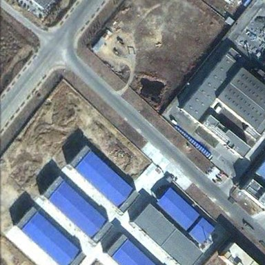 | 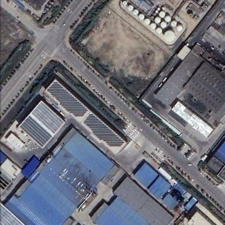 |

以下三张**推理时看不到**，只用于评估和画图：

| 真值变化图（白 = 变化） | t1 语义标签 | t2 语义标签 |
|:---:|:---:|:---:|
| 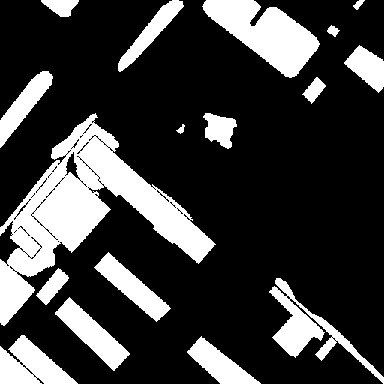 | 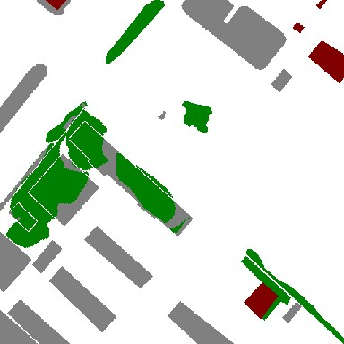 | 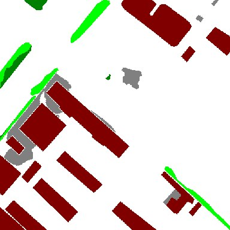 |

语义标签颜色：深红 建筑，深绿 低矮植被，亮绿 树木，灰 非植被地表，蓝 水体，红 运动场，白 未变化。

⬇️

## ② 检测器：MambaSCD-Base

- **输入**：t1、t2，两张 512×512×3
- **输出**：变化概率图 512×512（每像素 0–1），阈值 0.5 得到二值预测图

| 概率图（越亮越可能变化） | 二值预测（概率 > 0.5） | 对错分析 |
|:---:|:---:|:---:|
| 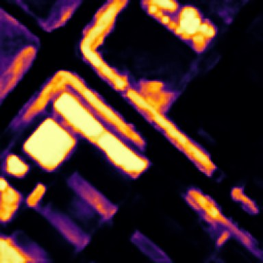 | 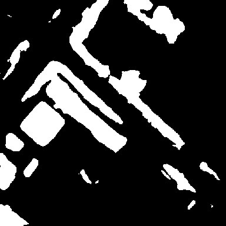 | 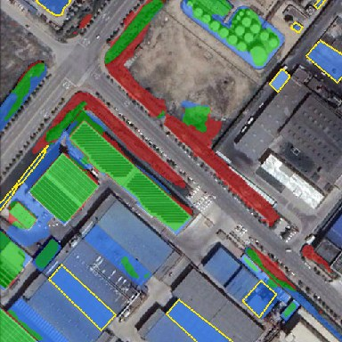 |

对错分析：绿对、红误检、蓝漏检；黄框是本图 13 个无信号漏检目标。本图 F1 58.5。

- 全测试集 F1 74.17；无信号漏检占真值像素 14.9%，是四个数据集里最高的（`summary.md`、`exp1_error_breakdown.md`）
- 如果把整块漏检全补对，F1 最多 +7.81，这是补漏方向的上限（`exp2_oracle.md`）

⬇️ 分两路：**补漏**看检测器没标的地方，**去误检**看检测器标了的地方

## ③ 补漏第 1 步：找候选（4 个来源）

- **输入**：t1、t2；检测器概率图
- **输出**：一组候选区域（每个是一张 512×512 的二值图 + 一个分数）。已被检测器预测覆盖一半以上的候选去掉。

| H1：AnyChange | B：SAM3 语义做差 | G0.05：检测器低概率 | C：SAM3 建筑实例差 |
|:---:|:---:|:---:|:---:|
| 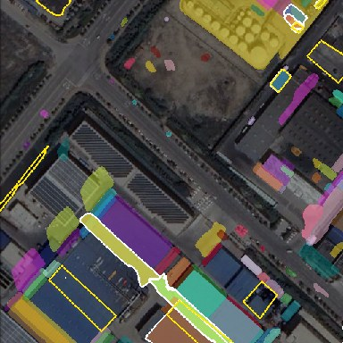 | 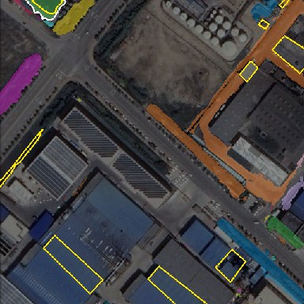 | 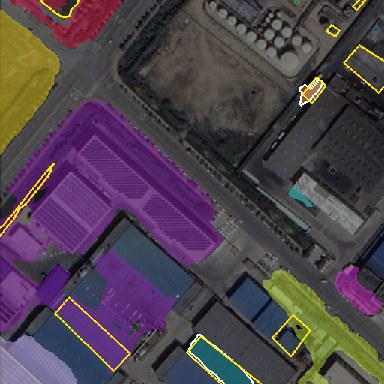 | 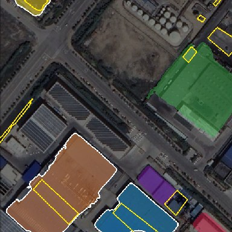 |
| 本图 99 个候选，找到 4 个目标 | 28 个，找到 2 个 | 13 个，找到 2 个 | 6 个，找到 4 个 |

- **H1 AnyChange**（SAM ViT-H）：在两期上各自分割出物体，比较同一位置前后的特征，差得多就当候选。
- **B SAM3 语义做差**：用文字提示让 SAM3 在两期上各画出 6 类地物，前后类别不同的区域就是候选。
- **G0.05 检测器低概率**：概率在 0.05–0.5 之间的区域，即检测器“有点怀疑但没标”的地方。
- **C SAM3 建筑实例差**：两期分别找出每栋建筑，前后对不上的（新建、拆除）或外观差别大的（改建）当候选。

每种颜色是一个候选，白框是盖住了某个黄框目标的候选。本图 13 个目标中，4 个来源合起来找到 7 个（各来源找到的有重叠）。四个来源互补：H1 擅长整片地物，C 擅长建筑改建。

- 全测试集覆盖率：H1 29.3%，B 19.7%，G0.05 16.7%，C 9.3%；合起来 52.2%（`exp4a_candidates.md`、`exp5a_anychange.md`）
- ⚠️ 问题：候选纯度只有约 5–10%，大部分候选是没变的地方；很多候选太大，把漏检和周围没变的区域连在一起（`exp4a_candidates.md`）

⬇️

## ④ 切细：把大候选切成小块（补漏和去误检共用）

- **输入**：一个候选（或检测器预测的一个连通区域）；t1、t2 叠成的 6 通道图
- **输出**：若干切块。只切面积 > 1192 像素的区域（SECOND 漏检目标面积中位数 298 的 4 倍）；小于 10 像素的块丢掉。

| 位置（青框为放大范围） | 一个大候选（H1，13,538 像素） | 超像素网格（约 880 片 = 图像面积 ÷ 298） | 切块结果（57 块） |
|:---:|:---:|:---:|:---:|
| 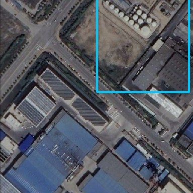 | 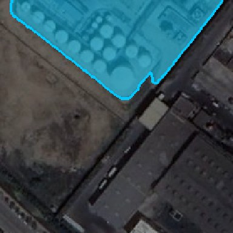 | 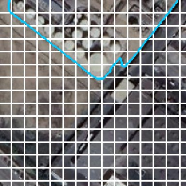 | 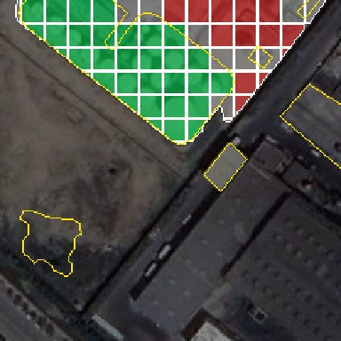 |

切块按真值着色：33 块正（绿），14 块负（红），10 块丢弃（灰）；黄线是真值。

- 按真值挑块（oracle）再补上：切细后 ΔF1 +6.96，不切细只有 +3.05。切细让“找到的”大部分能兑现（`exp5c_end_to_end.md`）

⬇️

## ⑤ 验证器：给每个切块打分（6b 训练中）

- **输入**：以切块为中心的正方形裁图（边长 = max(4 × 切块长边, 64)），包括 t1 裁图、t2 裁图、切块掩码、检测器概率裁图，外加下面 JSON 里的数值特征
- **输出**：一个数，即这块是真变化的概率 P ∈ [0, 1]

**正例**：真值标为变化（t1 低矮植被 → t2 建筑）

| t1 裁图 | t2 裁图 | 切块掩码 | 检测器概率 |
|:---:|:---:|:---:|:---:|
| 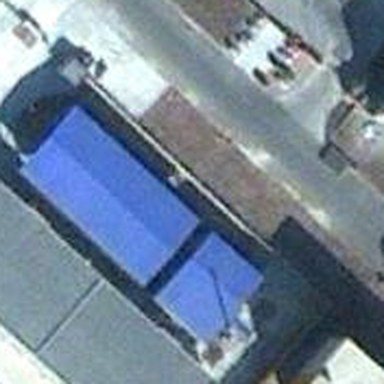 | 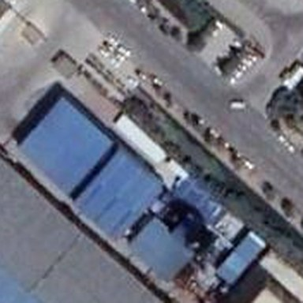 | 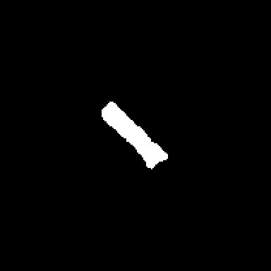 | 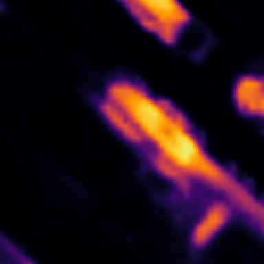 |

```json
{
  "image": "test_987.png",
  "source": "H1",
  "piece_bbox_xyxy": [360, 380, 403, 424],
  "piece_area_px": 632,
  "crop_xyxy": [294, 314, 470, 490],
  "crop_side_px": 176,
  "detector_prob": {"mean": 0.3929, "max": 0.6265, "p90": 0.5634},
  "label_rule": "gt_frac >= 0.5 -> 1, < 0.1 -> 0",
  "gt_frac": 0.9019,
  "label": 1,
  "transition": "t1 低矮植被 -> t2 建筑"
}
```

**负例**：真值未变化

| t1 裁图 | t2 裁图 | 切块掩码 | 检测器概率 |
|:---:|:---:|:---:|:---:|
| 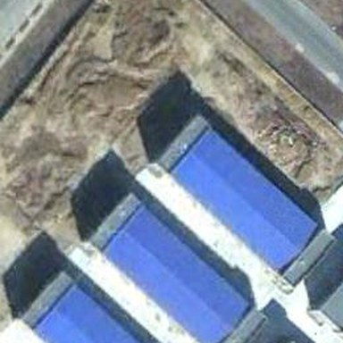 | 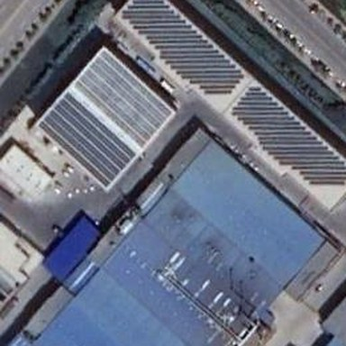 | 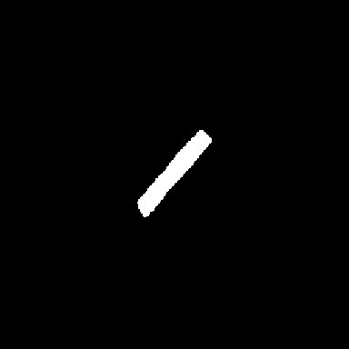 | 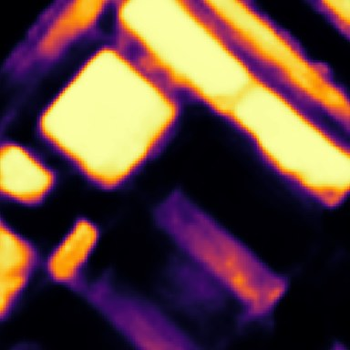 |

```json
{
  "image": "test_987.png",
  "source": "H1",
  "piece_bbox_xyxy": [118, 291, 174, 356],
  "piece_area_px": 997,
  "crop_xyxy": [16, 194, 276, 454],
  "crop_side_px": 260,
  "detector_prob": {"mean": 0.0202, "max": 0.0945, "p90": 0.041},
  "label_rule": "gt_frac >= 0.5 -> 1, < 0.1 -> 0",
  "gt_frac": 0.0,
  "label": 0
}
```

两段 JSON 是这两个切块的真实记录。`gt_frac`、`label`、`transition` 来自真值，只在训练时作标签，推理时验证器看不到。

**验证器 V1 的结构**

```
t1 裁图 → 冻结骨干（SAM ViT-H 或 RemoteCLIP）→ 在切块掩码内平均 → f1
t2 裁图 → 同一骨干                          → 在切块掩码内平均 → f2
[f1, f2, |f1 − f2|, 检测器概率统计] → 2–3 层 MLP → P(真变化)
```

输出示例（结构）：`{"image": "test_987.png", "piece_bbox_xyxy": [...], "p_change": ⏳ 待 6b}`

- ⚠️ 不训练、直接用现成信号打分，最好也只有 AUC 0.85；召回 80% 时误检率至少 29%，补进去会让 F1 下降（`exp5b_confirm.md`）
- 目标：被放过的切块中，真变化像素超过 F1/2（SECOND 约 37%）（`exp5c_end_to_end.md`）
- ⏳ V1 的 AUC、召回 80% / 90% 时误检率、像素精度：待 6b（`exp6b_verifier.md`）

⬇️ 按分数分两路处理

## ⑥a 补漏：高分切块直接并入

- **输入**：检测器二值图 + 分数高于阈值的候选切块
- **输出**：补漏后的二值图 512×512（按位“或”）

| 补之前：F1 58.5（召回 53.8） | oracle 补之后：F1 77.4（召回 88.3） |
|:---:|:---:|
| 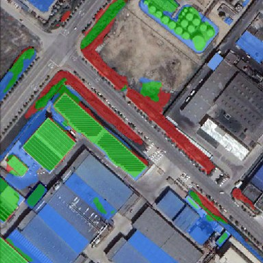 | 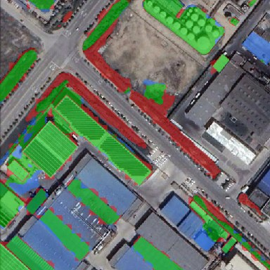 |

很多蓝色漏检变成了绿色。

- 全测试集 oracle 上界：ΔF1 +6.96（B + G0.05），再加 H1 为 +8.50（`exp5c_end_to_end.md`）
- ⚠️ 不用真值、只按检测器概率挑块：最好也是 −0.73，所以必须训练验证器（`exp5c_end_to_end.md`）
- ⏳ 用验证器 V1 挑块的实际 ΔF1：待 6b

## ⑥b 去误检：低分切块删掉

- **输入**：检测器二值图；它的每个连通区域按第 ④ 步切细，再用同一验证器打分
- **输出**：去误检后的二值图 512×512

| 检测器预测区域切块（红 = oracle 要删，绿 = 保留） | oracle 删之后：F1 66.6（精度 64.2 → 88.1） |
|:---:|:---:|
| 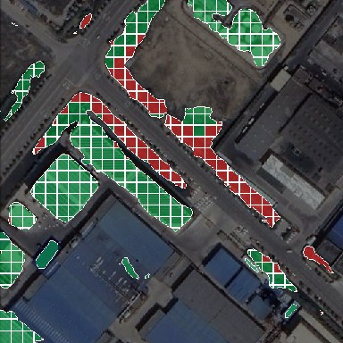 | 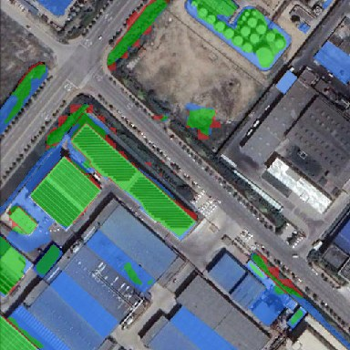 |

- 全测试集 oracle 上界：SECOND +5.74，SYSU +4.07；只删“整块都错”的区域：+2.43 / +1.17（数据在 `exp6e/*/oracle.json`，结果文件 `exp6e_fp_removal.md` 待写）
- ⏳ 验证器实际效果，以及对照基线（只按检测器自己的概率删块）：待 6e

⬇️

## ⑦ 最终变化图

| 检测器原始结果：F1 58.5 | 两路都做（oracle）：F1 85.9 | 最终二值图 |
|:---:|:---:|:---:|
|  | 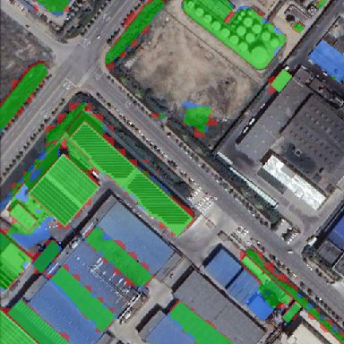 | 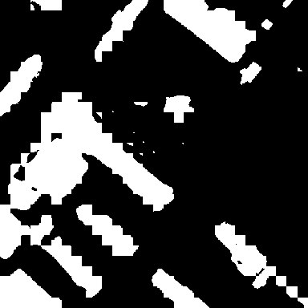 |

| 本图（test_987） | F1 | 精度 | 召回 |
|---|---:|---:|---:|
| 检测器 | 58.51 | 64.18 | 53.75 |
| + oracle 补漏 | 77.44 | 68.98 | 88.26 |
| + oracle 去误检 | 66.63 | 88.05 | 53.59 |
| 两路都做 | 85.92 | 83.85 | 88.10 |

这张图是挑出来演示用的，漏检和误检都多，所以提升比全测试集平均大得多。

- ⏳ 全测试集上用验证器两路都做的 F1；换检测器（SCanNet）、换数据集（SYSU 等）后是否仍有提升；LEVIR/WHU 上是否不下降：待 6c、6e

---

# 图 2　训练流程（验证器怎么训出来）

只用 SECOND 训练集，测试集不参与训练和调阈值。难点：官方检测器就是在训练集上训的，在训练图上几乎不漏检；直接在训练图上找候选，得到的样本和测试时完全不一样。所以先做交叉拟合。

## ① SECOND 训练集（已就绪）

- **输入**：2,968 对 t1、t2（512×512），每对都有真值变化图和两期语义标签
- **输出**：按图像划分好的 3 折

| t1（train_1010） | t2 | 真值变化图 | t1 语义标签 | t2 语义标签 |
|:---:|:---:|:---:|:---:|:---:|
| 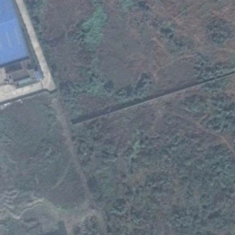 | 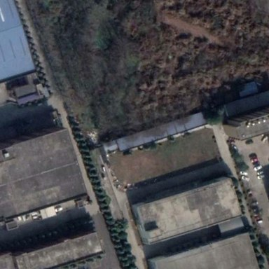 | 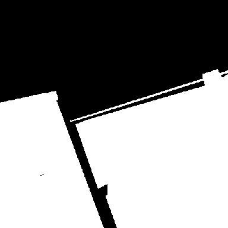 | 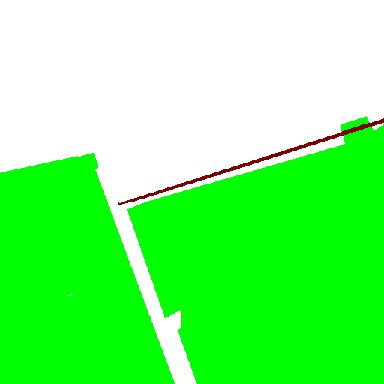 | 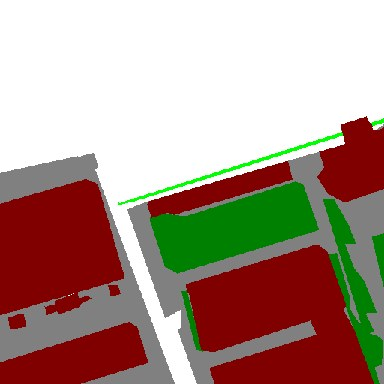 |
| | | 用来给切块打正负标签 | | 用来给正例写“前是什么、后是什么”（V2 用） |

⬇️

## ② 交叉拟合检测器（训练中，2026-10-19 已到 43.5k / 50k 步）

- **输入**：其中 2 折的影像和标签
- **输出**：3 个 MambaSCD-Base，每个只在“没见过”的那一折上输出概率图和二值图（512×512）。三折拼起来，就是整个训练集的“测试式”检测结果。

| 折 | 训练 | 选模型（内部验证） | 留出预测 |
|---|---:|---:|---:|
| fold0 | 1879 | 99 | 990 |
| fold1 | 1880 | 99 | 989 |
| fold2 | 1880 | 99 | 989 |

三折的留出部分互不重叠，合起来正好是全部 2,968 张。另从训练集按图像划出 297 张，作验证器的验证集（选阈值、早停）。

**训练配置**（fold0 真实记录，官方超参）：

```json
{
  "model_type": "MambaSCD_Base",
  "encoder_pretrained_path": "/guisongxia01/pangchao/wangyihan/models/VMamba/vssm_base_0229_ckpt_epoch_237.pth",
  "max_iters": 50000,
  "global_batch_size": 16,
  "batch_size": 8,
  "world_size": 2,
  "learning_rate": 0.0001,
  "weight_decay": 0.005,
  "lr_step_size": 10000,
  "crop_size": 512,
  "fold": 0
}
```

与官方的一处差别：官方单卡 batch 16，这里 2 卡 × 8（总数仍为 16），所以 BatchNorm 每卡只看到 8 张。

**内部验证 SeK**（每 500 步评一次，下表每 6k 步取一个点）：

| 步数 | 6k | 12k | 18k | 24k | 30k | 36k | 42k | 最好（步数） |
|---|---:|---:|---:|---:|---:|---:|---:|---:|
| fold0 | 0.226 | 0.220 | 0.209 | 0.218 | 0.212 | 0.208 | 0.212 | 0.226（6k） |
| fold1 | 0.173 | 0.182 | 0.191 | 0.190 | 0.190 | 0.189 | 0.190 | 0.198（10k） |
| fold2 | 0.246 | 0.236 | 0.228 | 0.233 | 0.237 | 0.236 | 0.237 | 0.246（6k） |

三折的最好 SeK 都出现在 6k–10k 步，之后基本持平。

- ⏳ 留出折上的检测结果和 F1：待 6a（`exp6a_pool.md`）。F1 应接近测试集的 74.17，否则说明交叉拟合样本和测试分布不一致。

⬇️

## ③ 训练候选池：在留出预测上重跑图 1 的 ③④（待做）

- **输入**：训练图 + 交叉拟合检测器的输出
- **输出**：所有切块，每块带来源、面积、所在图像、检测器概率统计（格式同图 1 第 ⑤ 步的 JSON）
- ⏳ 训练图上的候选与切块示意图；训练池与测试池的分布对比（正例率、检测器概率、来源占比、面积）：待 6a

⬇️

## ④ 自动打标签（待做）

- **输入**：切块 + 训练集真值变化图（+ 两期语义标签）
- **输出**：每块一个 0/1 标签；不人工标注，也不做正负样本平衡，保持真实比例

规则示意（用的是图 1 第 ④ 步的测试图，训练图的版本待 6a）：块内真变化 ≥ 50% → 1（绿），< 10% → 0（红），其余丢弃（灰）。


⬇️

## ⑤ 训练验证器（待做）

- **输入**：带标签的切块（图 1 第 ⑤ 步那样的裁图 + JSON）
- **输出**：验证器权重，以及在 297 张验证图上选出的阈值，供图 1 第 ⑥ 步使用

| 版本 | 做法 | 状态 |
|---|---|---|
| V1（主力） | 冻结骨干 + MLP，结构见图 1 第 ⑤ 步。损失按真实正例率加权。 | 等 6a 的候选池 |
| V2a | 本地 Qwen3.5-4B 用 LoRA 微调，只学回答“是 / 否” | V1 之后 |
| V2b | 同上，但先学说“t1 是什么、t2 是什么”，再下结论（理由由语义标签自动生成） | V1 之后 |
| V3（可选） | 在 V2b 基础上以“答对”为奖励做 GRPO 强化学习；仅当 V2b 明显好于 V2a 时做 | 视 V2 结果 |

- ⏳ 各版本在测试候选池上的 AUC、误检率、端到端 ΔF1：待 6b、V2、V3（`exp6b_verifier.md`）

---

# 当前进度

| 步骤 | 状态 | 结果文件 |
|---|---|---|
| 第 0 步：资源与耗时评估 | 完成。卫星版 DINOv3 无下载权限；Zero-OVCD 无公开代码 | `env.md` |
| 6a 交叉拟合候选池 | 三折检测器训练中（43.5k / 50k 步） | `exp6a_pool.md` |
| 6b 验证器 V1 + 端到端 | 等 6a | `exp6b_verifier.md` |
| 6e 去误检 | oracle 上界完成；对照基线和验证器待做 | `exp6e_fp_removal.md` |
| 6c 换检测器 / 换数据集 | SCanNet 代码和权重已就位 | `exp6c_generalization.md` |
| 6d 新候选来源 | RingMo-SAM 待做；Zero-OVCD 停止 | `exp6d_backlog.md` |

配图由 `code/probe/exp6_pipeline_figs.py` 生成，均来自实验 4–6 的真实输出；标 oracle 的结果用了真值，只代表上界。
